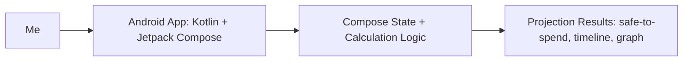

# SpendAhead

> A personal spending simulator that helps me see what happens to my money before I make a big purchase.

**Author:** Jimmy Casiano Diaz · **Course:** CMP 464/343 Product 1 · **Last updated:** November 2, 2026

---

## 1. About Me (the User)

I am a college student who also works and gets paid weekly. The main things competing for my money are my girlfriend/shared plans, bills and necessities, and things I personally want.

I like spending money on things I care about, like Pokémon cards, technology, LEGO, trips, and other hobbies. My problem is not always that I cannot afford something. A lot of the time I technically have enough money to buy it, but I am not sure how much of that money is actually safe to spend.

I also tend to keep everything in one mental bucket. I do not clearly separate what money is for me, what is for shared plans, and what needs to stay available for bills and necessities.

**The last 3 times this happened:**

1. I was at a Pokémon card show with my girlfriend and saw a lot of cards from my wishlist at good prices. If I bought everything I wanted, I probably could have spent around $1,500. I technically had the money, but my girlfriend reminded me that we had a Florida trip coming up. I realized spending that much at the card show could leave me with very little money for the trip, so I ended up buying nothing and mostly window shopping.

2. Two nights before the same Florida trip, my dog got sick and was throwing up blood, so my girlfriend and I took him to the emergency vet. The bill was around $1,200 and we split it 50/50, so my part was around $600. I did not mind spending the money because helping my dog was more important, but it showed me how quickly money that I thought could be used for something else could suddenly be needed.

3. After coming back from the trip, I wanted to upgrade my iPhone. I knew I could afford it at that moment, but buying it would leave me with almost nothing until my next paycheck. I decided to buy it anyway because I really wanted it. Afterward, I had around $11 and some change left until I got paid again.

**What it costs me:**

- Time: I repeatedly stop and mentally calculate what I need to survive until my next paycheck whenever I am considering a large purchase.
- Money: Large purchases can be hundreds or thousands of dollars. Forgotten recurring charges can also cause my account to temporarily go negative.
- Energy: I keep several things in my head at once, including checking balance, credit-card balance, bills, necessities, my next paycheck, and future plans.
- Joy: I like spending money on things I enjoy, but I can feel unsure about spending because I do not always know what portion of my balance is actually free.

---

## 2. Problem Statement

**Gut check:**

> I need to know how much of my money is actually safe to spend because the total in my account includes money that may already need to go toward bills, necessities, or future plans.

**Five Whys:**

1. Why do I sometimes end up with less money than I expected after a purchase?  
   Because I forget recurring charges or underestimate necessities.

2. Why do I forget or underestimate them?  
   Because I usually do not think about them until they happen.

3. Why do I not think about them ahead of time?  
   Because when I see money in my account, I mostly treat it as available.

4. Why do I treat it as available?  
   Because I do not clearly separate what money is for me, what is for shared plans, and what is for bills and necessities.

5. Why does that matter?  
   Because it makes me unsure about spending. When my available money gets low, even a small purchase can suddenly feel expensive because it represents a large percentage of everything I have left.

**Problem statement:**

> **When** I am about to make a large purchase, usually something in the hundreds or thousands of dollars,  
> **I struggle to** know how much of my money is actually safe to spend,  
> **which costs me** financial breathing room and can leave me with almost nothing until my next weekly paycheck.  
> **This happens because** I do not clearly separate money for myself, shared plans, bills, and necessities.  
> **Right now I** mentally estimate what I will need until my next paycheck, **but** I can forget recurring charges or underestimate what I will actually need.

**I'll know this is solved when:** I can make a large purchase without ending up with almost no money left before my next paycheck.

---

## 3. Existing Solutions

| What I use or tried | What it does well | Why it falls short *for me* |
|---|---|---|
| Mentally estimating until my next paycheck | It is fast and I can do it anywhere | I have to remember bills, food, transportation, credit, and other expenses at the same time |
| Checking account and credit-card balances | Shows how much money and credit I technically have available | It does not clearly show how much is already committed or how the rest of my week will look |
| PocketGuard | Shows accounts, bills, spending, recurring expenses, and savings goals | It seems more focused on transactions that already happened or are already scheduled. I want to test a purchase before making it and see a possible timeline of what happens afterward. It also feels like a lot to manage when I want something that simplifies the decision |

**The gap:** I can find ways to see what I already spent, what bills are coming, or how close I am to a savings goal, but I still do not have a simple way to test a purchase before I make it and see how that decision would affect the money I have left through my next few paychecks.

---

## 4. Features & Benefits

| Feature (what it does) | Benefit (how my life gets better) | MVP or Later? |
|---|---|---|
| Let me enter a purchase I am considering and simulate it before buying | I can see the consequence before spending instead of realizing afterward that I left myself with almost nothing | MVP |
| Show the next two paychecks, upcoming bills, necessities, and balance changes using a timeline and graph | I can visually see how the rest of my week and the next few weeks will go instead of keeping every number in my head | MVP |
| Show both technically available money and safe-to-spend money | I can tell the difference between having enough money to buy something and being comfortable spending that money | MVP |
| Save purchase history and show patterns | I could see how often I put myself in a tight position after large purchases | Later |
| Automatically detect recurring subscriptions and bills | I would be less likely to forget charges such as Apple subscriptions | Later |
| Compare multiple purchase scenarios side by side | I could compare buying with checking, buying with credit, or not buying at all | Later |

**MVP (2–3 features):**

- Simulate a hypothetical large purchase before making it.
- Show how the purchase affects my money over the next two paychecks using a timeline and graph.
- Show both technically available money and money that is actually safe to spend.

**Later:**

- Spending history and patterns.
- Automatic subscription detection.
- Bank and credit-card connections.
- Savings goals for trips, Christmas, or future purchases.
- Side-by-side scenario comparison.
- Smarter estimates based on previous spending.
- Persistent local storage using Room so balances, bills, paychecks, necessities, and scenarios can be saved between uses.

**Not doing:**

- Replacing a full budgeting product like PocketGuard.
- Investing or stock tracking.
- Taxes.
- Automatically moving money between accounts.
- Telling me whether I am allowed to buy something.
- Automatic bank integrations in the first version.

---

## 5. Tech Stack

### Front end

- **Surface:** Mobile
- **Tools:** Android Studio, Kotlin, Jetpack Compose
- **Why:** The problem usually happens when I am considering buying something, often while I am away from my computer or already using my phone. I also already have some experience building an Android app with Kotlin and Jetpack Compose.

### Back end

| Piece | Choice | Why |
|---|---|---|
| Server / API | None for MVP | The calculations can happen locally on the phone, so I do not need a server yet |
| Data storage | In-memory Compose state | The MVP only needs the values while I am testing a purchase. Persistent saved scenarios can be added later |
| Outside services (optional) | None for MVP | Manual input keeps the first version simple and avoids bank integrations |
| Hosting / deploy | Local Android app | The first version only needs to run on my phone or Android emulator |

### Architecture sketch

---

## 6. Open Questions

- Exactly how should "safe to spend" be calculated as the product becomes more advanced?
- How should required bills be separated from flexible necessities such as food, OMNY, and Uber?
- How should protected money for trips or other future plans affect the safe-to-spend amount?
- Should future versions save and compare multiple hypothetical purchase scenarios?
- When should the product consider me financially comfortable again after a large purchase?
- Should future versions use previous spending to help estimate necessities automatically?